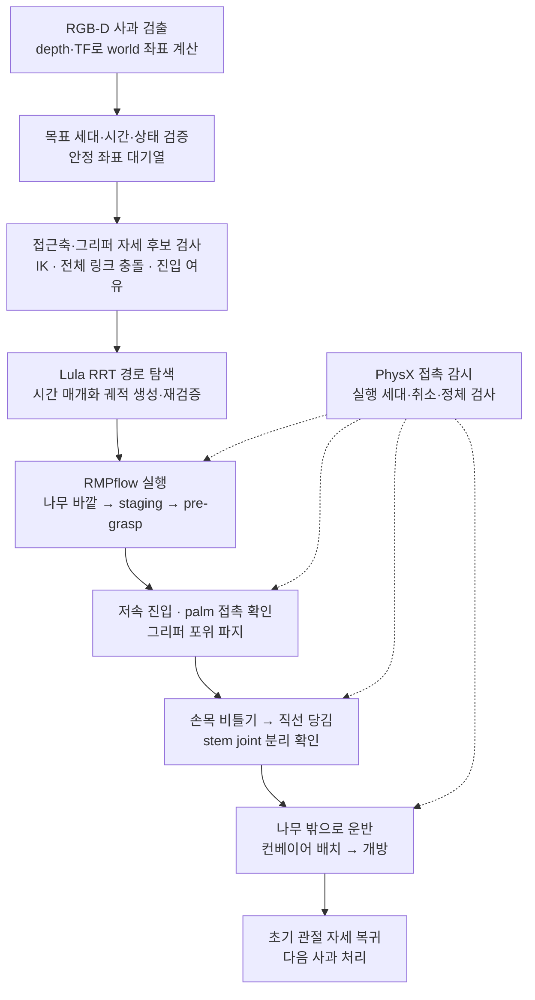
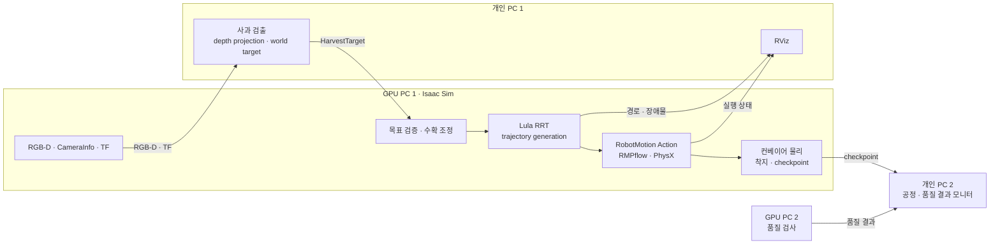

# Apple Pickr — 장애물 회피 기반 사과 수확 시뮬레이션

> NVIDIA Isaac Sim · Doosan M0617 · ROS 2 Jazzy  
> **Lula RRT 전역 경로 계획 → 시간 매개화 궤적 → RMPflow 실행 → PhysX 접촉 감시**

나뭇가지 사이의 사과를 찾아 접근하고, 세 손가락으로 감싼 뒤 **비틀고 당겨 줄기를 분리**하여 컨베이어에 내려놓는 로봇 수확 시스템입니다. RGB-D 기반 목표 인식, 충돌을 고려한 경로 계획, 접촉 기반 파지, 연속 수확과 실패 처리를 하나의 파이프라인으로 연결합니다.

핵심은 **사과까지 도달하는 경로**와 **사과에 접촉해 수확하는 동작**을 나누어 제어하는 것입니다. 큰 이동은 RRT와 궤적 생성기로 계획하고, 파지·비틀기·당김은 수확 상태 머신으로 실행하며, 실제 물리 접촉은 별도로 감시합니다.

**이 브랜치는 RRT + RMPflow 수확 로직을 보존한 `restore/rrt-rmpflow`입니다.** 기준 구현은 커밋 [`92d5365`](https://github.com/jonnykoh2008-ship-it/apple_pickr/commit/92d53651c7def809c34560a5ece80579718a99b6)이며, 이후 멀티로봇 통합 버전과 실행 구조가 다릅니다. USD에는 두 로봇이 있고 실행 시 한 로봇의 프로파일을 선택합니다.

## 핵심 기능

| 기능 | 구현 내용 | 주요 근거 |
|---|---|---|
| **RRT + RMPflow 모션 파이프라인** | 관절공간 경로 탐색, 속도·가속도 제약을 반영한 궤적 생성, 궤적 충돌 재검증과 실행 | [CollisionAwareMotion](apple_pick.py), [MotionEngine](vision_apple_pick.py) |
| **형상 기반 충돌 모델링** | 나무 구조의 로컬 PCA 기반 PhysX capsule·planning proxy 구성, 전체 로봇 링크 collision sphere 검사 | [충돌 형상 처리](apple_pick.py), [관련 테스트](tests/test_tree_collision_geometry.py) |
| **접근 방향·그리퍼 자세 탐색** | 여러 접근축의 IK·진입 여유 검사, authored gripper collision mesh를 이용한 swept clearance 평가 | [접근·파지 구현](apple_pick.py) |
| **접촉 기반 Twist & Pull** | palm 접촉과 손가락 선접촉 구분, 포위 파지, 손목 회전·직선 당김, stem joint 파손 확인 | [수확 실행](vision_apple_pick.py), [수확 명세](docs/features/harvesting.md) |
| **연속 다중 사과 수확** | 안정 좌표 대기열, 가까운 목표 우선 처리, 수확·배치·초기 자세 복귀 후 다음 목표 실행 | [수확 조정 노드](harvest_coordinator.py) |
| **실패 분류와 안전 정지** | 비접촉 접근 실패의 지연 재시도, 접촉 이후 실패의 안전 정지, reset 세대 변경에 따른 상태 초기화 | [조정 로직](harvest_coordinator.py), [관련 테스트](tests/test_harvest_coordinator.py) |
| **분산 인식·실행과 시각화** | 개인 PC의 RGB-D 목표 계산, GPU PC의 계획·Action 실행, RViz용 경로·장애물·상태 발행 | [인식 노드](base_apple_detector.py), [시각화 발행](motion_planning_visualization.py) |
| **컨베이어 공정 연결** | 배치·개방 동작 분리, 사과 착지·검사 checkpoint 추적, 품질 결과 모니터링용 인터페이스 | [착지·checkpoint](conveyor_checkpoint_tracker.py), [배치 조정](conveyor_place_coordinator.py) |

## 수확이 진행되는 방식



### 1. 경로 계획과 물리 실행을 분리합니다

`CollisionAwareMotion`은 같은 나무 장애물을 **RRT와 RMPflow 양쪽에 등록**합니다. RRT로 구한 waypoint는 Lula trajectory generator로 시간 매개화하고, 생성된 궤적의 관절 제한과 충돌을 검사한 뒤 실행합니다. RMPflow는 실행 중 목표를 추종하고, PhysX contact report는 실제 로봇과 나무의 접촉을 감시합니다.

나무 밖 운반 구간에서는 현재 관절 자세와 가까운 IK 해를 구해 c-space 계획에 사용합니다. 주기 관절의 동등한 각도도 고려해 불필요하게 크게 회전하는 경로를 줄입니다. 초기 자세 복귀에도 관절공간 경로 계획을 적용합니다.

관련 코드: [`apple_pick.py`](apple_pick.py)의 `plan_rrt_trajectory`, `plan_rrt_cspace_trajectory`, `select_short_periodic_goal`과 [`vision_apple_pick.py`](vision_apple_pick.py)의 `_run_rrt_fsm_state`, `_return_to_initial`.

### 2. 복잡한 나무 형상을 계획 가능한 장애물로 바꿉니다

나무 mesh의 연결 성분을 나누고, 길이 방향의 로컬 구간마다 PCA로 두께와 방향을 추정합니다. 이를 바탕으로 물리 충돌용 capsule과 경로 계획용 proxy를 구성합니다. 로봇은 TCP뿐 아니라 **전체 링크 collision sphere**로 검사합니다.

이 브랜치에서는 가는 가지와 잎을 장애물에서 제외하고, 경로 주변 proxy를 선별하는 시뮬레이션 튜닝을 사용합니다. 따라서 모든 식생에 대한 충돌 회피를 보장하는 모델은 아닙니다. 적용 기준과 임시값은 [수확 명세](docs/features/harvesting.md)에 구분되어 있습니다.

### 3. 접촉을 수확 단계의 전환 조건으로 사용합니다

접근 후보는 마지막 진입 구간의 IK와 충돌 여유를 먼저 검사합니다. 그리퍼 개구는 관절각만으로 추정하지 않고, 실제 authored collision mesh를 접근 경로로 sweep하여 사과와의 여유를 평가합니다.

저속 접근 중 palm이 사과에 닿으면 자세를 유지하고 파지로 넘어갑니다. 손가락이 먼저 닿는 경우는 별도로 판정합니다. 파지 이후에는 손목을 비틀고 직선으로 당기며, **stem joint의 실제 파손 이벤트**를 확인해 분리를 판정합니다. 명령 종료만으로 수확 성공을 처리하지 않습니다.

물리 TCP는 palm 로컬 좌표에 정의하고, Lula의 제어 frame인 `link_6` 목표로 변환합니다. 그리퍼 형상과 제어 frame 사이의 오프셋을 명시적으로 다룹니다.

### 4. 연속 작업에서 실패의 위험도를 구분합니다

안정화된 사과 좌표를 `target_id`별로 관리하며, 실행 중인 목표는 새 검출로 바꾸지 않습니다. 대기 중인 목표는 최신 안정 좌표로 갱신합니다.

- **비접촉 접근 실패**: 일반 대기열을 처리한 뒤 한 번 재시도합니다.
- **접촉 이후 또는 파지 이후 실패**: `SAFETY_STOPPED`로 전환하고 대기열을 폐기합니다. reset 세대가 바뀌기 전에는 새 수확을 실행하지 않습니다.
- **Reset·장면 변경**: `reset_id`와 `scene_version`으로 이전 목표·계획의 재사용을 막습니다.
- **Pause**: 모션 시간 판정은 simulation time을 사용하므로 일시정지와 함께 멈춥니다.

자세한 규칙은 [수확 및 파지](docs/features/harvesting.md), [TF 및 시간](docs/architecture/tf_frames.md), [ROS 2 인터페이스](docs/architecture/ros2_interfaces.md)에 있습니다.

## 시스템 구성



수확 경로의 계획과 최종 실행 판단은 GPU PC 1이 담당합니다. 개인 PC 1은 영상에서 목표 좌표를 계산하고 계획 결과를 표시합니다. RViz는 표시 경로이며, 안전 정지 판단은 GPU PC 1에서 수행합니다.

품질 검사는 별도 하위 시스템입니다. 이 브랜치의 [품질 명세](docs/features/quality_grading.md)는 **고정 카메라·단일 사과의 OpenCV 크기 분류 MVP**를 기준으로 합니다. raw 카메라 구독부터 ROI/tracker와 품질 결과까지의 전체 자동 연결은 후속 통합 범위를 포함하므로, 위 그림은 PC별 책임을 보여 주며 전체 공정의 검증 완료를 뜻하지 않습니다.

### 두 로봇의 자산과 프로파일

| 프로파일 | M0617 Prim | 수확 영역 | 초기 관절 자세 (deg) | D455 Prim |
|---|---|---|---|---|
| `robot_01` | `/World/Xform_01/m0617_01` | `/World/Xform` | `[0, 0, -90, 0, 90, 0]` | `/World/base_rsd455_01` |
| `robot_02` | `/World/Xform_02/m0617_02` | `/World/Xform_03` | `[0, 0, 90, 0, -90, 0]` | `/World/base_rsd455_02` |

실행 시 `--robot-id`로 한 프로파일을 선택합니다. 각 프로파일은 articulation root, 로봇·그리퍼, 나무·사과, 카메라와 초기 자세를 함께 선택합니다. 각 로봇의 articulation root는 `m0617_rail/root_joint`이며, M0617 본체는 자신의 `FixedJoint`로 rail mount에 연결됩니다. 사과의 `PhysicsFixedJoint`는 각 가지 assembly 내부에서 `branchbody → applebody`를 연결합니다.

**두 로봇의 동시 운용 namespace·목표 배분과 로봇 간 충돌 회피는 이 보존 버전의 완료 기능으로 제시하지 않습니다.** 레일도 고정 마운트로 사용하며 이동 계획·실행은 범위 밖입니다.

## 기술적 문제와 해결 방식

| 문제 | 적용한 방식 |
|---|---|
| 목표 pose만 추종하면 나뭇가지 사이의 우회 경로를 확보하기 어려움 | RRT 전역 경로 → 시간 매개화 → 전체 링크 충돌 재검증 → RMPflow 실행 |
| 나무 전체의 거친 충돌 근사가 통로까지 막음 | 연결 성분·로컬 PCA 기반 capsule과 voxel proxy, 경로 주변 장애물 선별 |
| 손끝이 사과에 먼저 닿아 진입과 파지를 방해함 | 그리퍼 mesh의 swept clearance로 진입 자세를 고르고 palm 접촉과 선접촉을 구분 |
| 명령은 끝났지만 사과가 줄기에 남거나 그리퍼를 따라오지 않음 | stem joint 파손 감시와 파지 이후 사과 추종 확인 |
| 나무 밖 운반·복귀에서 관절이 크게 우회함 | 현재 자세와 가까운 IK seed·주기 관절 동등각 처리, c-space 계획 |
| 실패한 사과 때문에 연속 작업이 반복되거나 위험한 자세에서 다음 작업을 시작함 | 지연 재시도와 접촉 이후 안전 정지를 분리하고 reset 세대로 해제 |

구현 세부 사항은 [모션 코드](apple_pick.py), [실행 엔진](vision_apple_pick.py), [연속 수확 조정](harvest_coordinator.py)에서 확인할 수 있습니다. 표는 코드에 적용한 설계를 설명하며, 성능 향상률이나 성공률 측정 결과를 제시한 것은 아닙니다.

## 기술 스택과 실행 환경

| 구분 | 사용 기술 |
|---|---|
| 시뮬레이션·물리 | NVIDIA Isaac Sim 5.1.0 · USD · PhysX |
| 로봇·그리퍼 모델 | Doosan M0617 6-DOF × 2 · Robotiq AGS-001-MTCP 3-finger soft gripper |
| 모션 | Lula IK · RRT · C-space trajectory generation · RMPflow |
| 인식·좌표 | RGB-D · CameraInfo · TF · OpenCV |
| 분산 통신 | ROS 2 Jazzy · Fast DDS · Topic / Service / Action |
| 실행 환경 | Ubuntu 24.04 · Isaac Python 3.11 · 시스템 ROS Python 3.12 |
| 구성 장비 | GPU 노트북 2대 · 개인 Linux 노트북 2대 · 2.5Gbps Ethernet 스위치 |

그리퍼는 rigid finger와 compliant contact로 근사합니다. 이 저장소의 수확은 시뮬레이션 구현이며 실물 과수원 수확 성능을 의미하지 않습니다.

## 실행 안내

### 로봇 프로파일을 선택한 standalone 수확

Isaac Sim 5.1.0과 저장소의 USD·로봇 자산이 준비된 환경에서 실행합니다. `ISAAC_SIM_ROOT`는 설치 경로에 맞게 바꿉니다.

```bash
git clone --branch restore/rrt-rmpflow https://github.com/jonnykoh2008-ship-it/apple_pickr.git
cd apple_pickr

export ISAAC_SIM_ROOT=/home/rokey/isaacsim
"$ISAAC_SIM_ROOT/python.sh" apple_pick.py --robot-id robot_01
```

두 번째 프로파일은 `--robot-id robot_02`로 선택합니다. standalone 실행과 영상 목표를 수신하는 ROS 통합 실행은 진입점이 다릅니다.

### ROS 2 분산 실행 준비

통합 실행 진입점은 [`vision_apple_pick.py`](vision_apple_pick.py), 목표 인식은 [`base_apple_detector.py`](base_apple_detector.py), 수확 조정은 [`harvest_coordinator.py`](harvest_coordinator.py)입니다.

- 모든 PC의 Fast DDS 설정·메시지 버전을 맞추고 통합용 `ROS_DOMAIN_ID=101`을 사용합니다.
- Isaac 실행에 필요한 custom interface는 **Python 3.11용으로 별도 빌드**하고, 해당 install prefix를 `APPLEPROJ_INTERFACES_PREFIX`로 지정해야 합니다. 시스템 ROS Python 3.12 빌드와 구분합니다.
- 이 버전의 통합 스크립트는 Isaac ROS bridge 경로 `/home/rokey/isaacsim/exts/isaacsim.ros2.bridge/jazzy`를 사용합니다. 다른 설치 경로에서는 코드의 경로 설정을 먼저 확인해야 합니다.
- `base_apple_detector.py`는 `--robot-id`가 필수입니다. 프로파일 선택만으로 로봇별 topic/action 연결이 모두 설정되었다고 가정하지 말고 각 실행 파일의 토픽 설정과 계약을 대조해야 합니다.
- `harvest_coordinator.py`는 `--execute` 유무에 따라 실행 여부가 달라집니다.

상세 계약은 [ROS 2 인터페이스](docs/architecture/ros2_interfaces.md), [TF·시간](docs/architecture/tf_frames.md), [하드웨어·네트워크](docs/architecture/hardware_network.md)를 참고합니다.

## 검증 범위와 한계

저장소에는 다음 영역의 테스트가 포함되어 있습니다.

| 영역 | 테스트 |
|---|---|
| 나무 충돌 형상·proxy 기하 | [test_tree_collision_geometry.py](tests/test_tree_collision_geometry.py) |
| RRT 설정·모션 실행 정책 | [test_m0617_rrt_config.py](tests/test_m0617_rrt_config.py) · [test_motion_execution_policy.py](tests/test_motion_execution_policy.py) |
| 연속 수확·경로 조정 | [test_harvest_coordinator.py](tests/test_harvest_coordinator.py) · [test_harvest_route_planner.py](tests/test_harvest_route_planner.py) |
| 컨베이어 착지·배치·분류 제어 | [checkpoint](tests/test_conveyor_checkpoint_tracker.py) · [place](tests/test_conveyor_place_coordinator.py) · [sort](tests/test_conveyor_sort_controller.py) |
| 모션 시각화 | [test_motion_planning_visualization.py](tests/test_motion_planning_visualization.py) |

테스트 파일의 존재와 실제 Isaac Sim 실행 검증은 구분합니다. 이 README 개편에서는 문서와 코드의 대응을 확인했으며, 테스트 재실행·Isaac Sim 시연은 수행하지 않았습니다. 수확 성공률·사이클 시간·충돌률은 공개 가능한 측정 근거가 정리되어 있지 않아 수치로 제시하지 않습니다.

남은 주요 범위는 두 로봇 동시 운용 계약과 상호 충돌 처리, 품질 검사 전체 공정 연결, 다양한 배치에서의 반복 성능 측정입니다. 착색·손상 판정, 도메인 무작위화와 레일 이동을 이 브랜치의 완료 기능으로 포함하지 않습니다. 푸셔 실행 코드가 있으나 전체 물리 분류 공정의 완료 여부는 별도 확인이 필요합니다.

## 문서와 코드

| 관심 주제 | 문서·진입점 |
|---|---|
| 전체 구조·PC별 책임 | [시스템 개요](docs/architecture/system_overview.md) · [작업 규칙](AGENTS.md) |
| 수확·충돌 회피·파지 | [수확 명세](docs/features/harvesting.md) · [apple_pick.py](apple_pick.py) · [vision_apple_pick.py](vision_apple_pick.py) |
| 인식·좌표 변환 | [수확 인식](docs/features/harvest_perception.md) · [base_apple_detector.py](base_apple_detector.py) |
| ROS 2·시간·네트워크 | [인터페이스](docs/architecture/ros2_interfaces.md) · [TF](docs/architecture/tf_frames.md) · [네트워크](docs/architecture/hardware_network.md) |
| 컨베이어·품질·모니터링 | [컨베이어](docs/features/conveyor.md) · [품질 분류](docs/features/quality_grading.md) · [모니터 소스](appleproj_personal_pc2/) |
| USD·물리 자산 | [자산 요구사항](docs/assets/asset_requirements.md) · [M0617 USD](m0617_3fgripper08201638.usd) |
| 개발 단계·후속 계획 | [MVP](docs/phases/phase_1_mvp.md) · [AI·무작위화](docs/phases/phase_2_ai_randomization.md) · [푸셔](docs/phases/phase_2_pusher.md) · [시스템 통합](docs/phases/phase_3_system_integration.md) |
